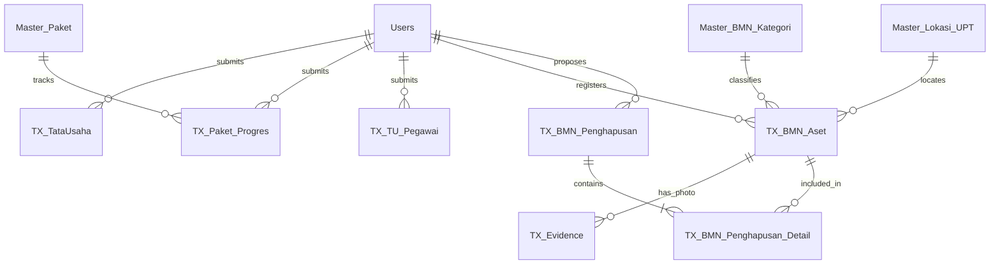

# DATA_SCHEMA.md — Skema Basis Data Relasional: SIKAP
**Sistem Informasi Keuangan, Anggaran, dan Kepegawaian**  
*Subbag Tata Usaha — Direktorat Pemantauan dan Operasi Armada (Dit. POA)*  
*Database Satelit:* `RadarPOA_SIKAP_DB` | *Database Master:* `RadarPOA_Master_DB`

---

## 1. Konvensi Kolom Standar Relasional (Relational Audit Columns)

Setiap tabel transaksi (`TX_*`) pada basis data SIKAP secara wajib mewarisi 10 kolom standar audit berikut pada posisi kolom terdepan:

| # | Nama Kolom | Tipe Data | Format / Nilai | Nullable | Deskripsi & Aturan Bisnis |
|---|---|---|---|:---:|---|
| 1 | `RowID` | Text (PK) | `TU-YYYY-XXXXX` `BMN-UUID` `HPS-YYYY-XXXX` | Tidak | Primary key unik immutable untuk setiap baris transaksi. |
| 2 | `DivisiID` | Text (FK) | `DIV-TU` | Tidak | Mengidentifikasi kepemilikan data (selalu `DIV-TU` untuk SIKAP). |
| 3 | `Periode` | Text | `YYYY-MM-WW` atau `YYYY-MM` | Tidak | Penanda periode pelaporan mingguan atau bulanan. |
| 4 | `SubmittedBy` | Text (FK) | `UserID` (Ref: `Users`) | Tidak | Identitas akun staf/pejabat pembuat data. |
| 5 | `Timestamp` | DateTime | `YYYY-MM-DDTHH:mm:ssZ` | Tidak | Waktu persis penulisan data ke spreadsheet. |
| 6 | `Status` | Enum | `ACTIVE` `SUPERSEDED` `VOID` | Tidak | Status daur hidup baris data dalam model non-destruktif. |
| 7 | `SupersedesRowID`| Text (FK) | `RowID` (Self) | Ya | Berisi `RowID` lama jika baris ini merupakan revisi pengganti. |
| 8 | `VoidReason` | Text | Teks Bebas | Ya | Alasan resmi pembatalan entri (wajib diisi jika `Status = 'VOID'`). |
| 9 | `VoidedBy` | Text (FK) | `UserID` (Ref: `Users`) | Ya | Akun pejabat (Kadiv/Direktur) yang menganulir data. |
| 10| `VoidedAt` | DateTime | `YYYY-MM-DDTHH:mm:ssZ` | Ya | Waktu pencatatan pembatalan data. |

---

## 2. Tabel Transaksi Satelit `RadarPOA_SIKAP_DB`

### 2.1 `TX_TataUsaha` — Realisasi Anggaran (SP2D & Akrual)
Mencatat pelaporan mingguan serapan DIPA Subbag Tata Usaha berbasis matriks 2x2.

| # | Nama Kolom | Tipe Data | Nullable | Contoh Nilai | Aturan Bisnis & Validasi |
|---|---|---|:---:|---|---|
| 1-10 | *(Kolom Standar)* | — | — | — | `RowID` format `TU-YYYY-XXXXX`. |
| 11 | `PaguReguler` | Number (IDR) | Tidak | `15000000000` | Pagu tahunan DIPA Induk reguler. Wajib $\ge 0$. |
| 12 | `PaguABT` | Number (IDR) | Tidak | `2500000000` | Pagu Anggaran Belanja Tambahan. Wajib $\ge 0$. |
| 13 | `RealisasiSP2D_Minggu` | Number (IDR) | Tidak | `350000000` | Konsolidasi kas cair SP2D minggu ini (`Reguler + ABT`). |
| 14 | `RealisasiAkrual_Minggu`| Number (IDR) | Tidak | `420000000` | Konsolidasi capaian fisik minggu ini (`Reguler + ABT`). |
| 15 | `RealisasiSP2D_Reguler_Minggu` | Number (IDR) | Tidak | `300000000` | Kas cair SP2D bersumber dari Pagu Reguler minggu ini. |
| 16 | `RealisasiSP2D_ABT_Minggu` | Number (IDR) | Tidak | `50000000` | Kas cair SP2D bersumber dari Pagu ABT minggu ini. |
| 17 | `RealisasiAkrual_Reguler_Minggu`| Number (IDR) | Tidak | `380000000` | Komitmen fisik bersumber dari Pagu Reguler minggu ini. |
| 18 | `RealisasiAkrual_ABT_Minggu` | Number (IDR) | Tidak | `40000000` | Komitmen fisik bersumber dari Pagu ABT minggu ini. |
| 19 | `CatatanRevisiPagu` | Text | Ya | `Revisi DIPA Ke-2 Hal III` | Wajib diisi jika nilai `PaguReguler` atau `PaguABT` berbeda dari laporan sebelumnya. |

---

### 2.2 `TX_Paket_Progres` — Monitoring Siklus Pengadaan Paket
Merekam kemajuan fisik dan keuangan paket pengadaan barang/jasa lintas divisi.

| # | Nama Kolom | Tipe Data | Nullable | Contoh Nilai | Aturan Bisnis & Validasi |
|---|---|---|:---:|---|---|
| 1-10 | *(Kolom Standar)* | — | — | — | `RowID` format `PKT-YYYY-XXXXX`. |
| 11 | `PaketID` | Text (FK) | Tidak | `PKT-2026-001` | Mengacu pada `Master_Paket.PaketID`. |
| 12 | `TahapPekerjaan` | Enum | Tidak | `PELAKSANAAN` | Nilai: `PERSIAPAN`, `PEMILIHAN`, `KONTRAK`, `PELAKSANAAN`, `BAST`, `SELESAI`. |
| 13 | `NilaiKontrak` | Number (IDR) | Ya | `850000000` | Nominal perjanjian kontrak. Wajib jika tahap $\ge$ `KONTRAK`. |
| 14 | `RekananPenyedia` | Text | Ya | `PT Bahari Nusantara` | Nama vendor resmi. Wajib jika tahap $\ge$ `KONTRAK`. |
| 15 | `NomorKontrak` | Text | Ya | `SPK/01/TU/III/2026` | Nomor kontrak dinas. Wajib jika tahap $\ge$ `KONTRAK`. |
| 16 | `ProgresFisikPct` | Number (%) | Tidak | `75.5` | Persentase capaian pekerjaan riil di lapangan (`0.0` s.d. `100.0`). |
| 17 | `RealisasiKeuangan` | Number (IDR) | Tidak | `637500000` | Kas negara yang telah dibayarkan kepada rekanan. |
| 18 | `KendalaKeterangan` | Text | Ya | `Menunggu suplai material` | Catatan kendala teknis atau deviasi kurva S. |
| 19 | `EvidenceUrl` | Text (URL) | Ya | `https://drive.google.com/...`| Tautan berkas kontrak atau dokumentasi fisik di Google Drive. |

---

### 2.3 `TX_TU_Pegawai` — Snapshot Headcount Kepegawaian
Mencatat struktur sumber daya manusia aparatur di Subbag Tata Usaha.

| # | Nama Kolom | Tipe Data | Nullable | Contoh Nilai | Aturan Bisnis & Validasi |
|---|---|---|:---:|---|---|
| 1-10 | *(Kolom Standar)* | — | — | — | `RowID` format `PEG-YYYY-XXXXX`. |
| 11 | `Kategori` | Enum | Tidak | `P3K_PARUH_WAKTU` | Nilai: `PNS`, `P3K`, `P3K_PARUH_WAKTU`, `PJLP`, `MAGANG`. |
| 12 | `Jumlah` | Integer | Tidak | `14` | Jumlah personil aparatur aktif pada kategori terkait ($\ge 0$). |
| 13 | `Keterangan` | Text | Ya | `2 orang mutasi ke Pangkalan Batam` | Catatan dinamika rotasi, promosi, mutasi, atau pensiun. |

---

### 2.4 `TX_BMN_Aset` — Register Inventaris Fisik Granular (Anti-Jebret)
Tabel induk seluruh aset fisik individual BMN. Setiap baris mewakili 1 unit fisik nyata (1 item = 1 baris).

| # | Nama Kolom | Tipe Data | Nullable | Contoh Nilai | Aturan Bisnis & Validasi |
|---|---|---|:---:|---|---|
| 1-10 | *(Kolom Standar)* | — | — | — | `RowID` format `BMN-` + UUID 14 karakter. |
| 11 | `AsetID` | Text (UUID) | Tidak | `BMN-A1B2C3D4E5F6` | ID fisik permanen dan stabil dari inventaris. |
| 12 | `KodeBarang` | Text | Tidak | `3050104001` | Kode katalog 10 digit resmi Kementerian Keuangan. |
| 13 | `NUP` | Text / Int | Tidak | `1` | Nomor Urut Pendaftaran fisik unik per KodeBarang. |
| 14 | `NamaBarang` | Text | Tidak | `Laptop HP EliteBook G8`| Deskripsi nama resmi aset inventaris. |
| 15 | `MerekTipe` | Text | Ya | `Core i7 16GB SSD 512GB`| Spesifikasi detail pabrikan/tipe. |
| 16 | `KategoriPencatatan` | Enum | Tidak | `BUKU` | `BUKU` (Intrakomptabel $\ge$ kapitalisasi) vs `REGULER` (Ekstrakomptabel). |
| 17 | `KodeKategori` | Text (FK) | Tidak | `KAT-TIK` | Ref: `Master_BMN_Kategori.KodeKategori`. |
| 18 | `TanggalPerolehan` | Date | Tidak | `2023-05-14` | Tanggal pembelian / perolehan BAST pertama kali. |
| 19 | `NilaiPerolehan` | Number (IDR) | Tidak | `22500000` | Nilai beli kotor saat pengadaan awal. Wajib $\ge 0$. |
| 20 | `NilaiBuku` | Number (IDR) | Tidak | `13500000` | Nilai buku akuntansi terkini setelah penyusutan SAKTI. |
| 21 | `Kondisi` | Enum | Tidak | `BAIK` | Status fisik: `BAIK`, `RUSAK_RINGAN`, `RUSAK_BERAT`. |
| 22 | `LokasiID` | Text (FK) | Tidak | `UPT-JKT` | Ref: `Master_Lokasi_UPT.LokasiID` (UPT penanggung jawab). |
| 23 | `LokasiDetailRuangan`| Text | Ya | `Ruang Server Lantai 3` | Spesifikasi ruangan, anjungan kapal, atau gedung penempatan. |
| 24 | `Latitude` | Number | Ya | `-6.175392` | Lintang koordinat penempatan geotagging (-90 s.d. 90). |
| 25 | `Longitude` | Number | Ya | `106.827153` | Bujur koordinat penempatan geotagging (-180 s.d. 180). |
| 26 | `SumberLokasi` | Enum | Tidak | `EXIF_GPS` | Asal koordinat: `EXIF_GPS`, `GPS_PENGUNGGAH`, `PROFIL_PENGUNGGAH`, `MANUAL`, `IMPOR_SAKTI`. |
| 27 | `JarakKeUPT_Km` | Number | Ya | `4.25` | Jarak dalam kilometer ke UPT terdekat hasil kalkulasi Haversine. |
| 28 | `TanggalVerifikasi` | Date | Ya | `2026-10-20` | Tanggal verifikasi fisik lapangan terakhir oleh tim BMN. |
| 29 | `FotoEvidenceID` | Text | Ya | `EV-F1E2D3C4B5A6` | Ref: `TX_Evidence.EvidenceID` (file foto fisik aset). |
| 30 | `StatusAset` | Enum | Tidak | `AKTIF` | Daur hidup aset: `AKTIF`, `DALAM_PENGHAPUSAN`, `DIHAPUS`. |
| 31 | `PenghapusanID` | Text (FK) | Ya | `HPS-2026-0004` | Ref: `TX_BMN_Penghapusan.PenghapusanID` jika sedang diajukan hapus. |
| 32 | `KapalID` | Text | Ya | `KP-HIU-01` | Diisi jika inventaris melekat pada kapal pengawas armada. |
| 33 | `ImportBatchID` | Text | Ya | `BATCH-20261026-01` | Penanda batch impor jika bersumber dari Smart Bulk Import SAKTI. |
| 34 | `Keterangan` | Text | Ya | `Unit operasional staf anggaran` | Catatan tambahan kondisi fisik atau riwayat perbaikan. |

---

### 2.5 `TX_BMN_Penghapusan` — Berkas Usulan Penghapusan Kemenkeu
Mencatat berkas usulan legal penghapusan/pemusnahan BMN menuju DJKN/KPKNL Kemenkeu.

| # | Nama Kolom | Tipe Data | Nullable | Contoh Nilai | Aturan Bisnis & Validasi |
|---|---|---|:---:|---|---|
| 1-10 | *(Kolom Standar)* | — | — | — | `RowID` format `HPS-YYYY-XXXXX`. |
| 11 | `PenghapusanID` | Text (PK) | Tidak | `HPS-2026-0004` | Nomor registrasi berkas usulan penghapusan. |
| 12 | `Tahap` | Enum | Tidak | `DRAFT_USULAN` | State machine: `DRAFT_USULAN`, `SURAT_USULAN`, `PERSETUJUAN_KEMENKEU`, `SK_PENGHAPUSAN`, `BAST_SELESAI`, `DITOLAK`, `VOID`. |
| 13 | `AlasanPenghapusan` | Enum | Tidak | `RUSAK_BERAT` | Kategori: `RUSAK_BERAT`, `KADALUWARSA`, `HILANG`, `HIBAH`, `PENJUALAN_LELANG`. |
| 14 | `KeteranganAlasan` | Text | Tidak | `Biaya perbaikan melebihi nilai perolehan (tidak ekonomis)` | Pertimbangan hukum/teknis penghapusan. |
| 15 | `NomorSuratUsulan` | Text | Ya | `B.145/DJPSDKP/TU/2026` | Nomor surat pengantar Satker ke Pengelola Barang. |
| 16 | `TanggalSuratUsulan`| Date | Ya | `2026-10-15` | Tanggal surat usulan Satker. |
| 17 | `EvidenceSuratUsulan`| Text (URL) | Ya | `https://drive.google.com/...`| Link PDF scan surat usulan bertandatangan di Drive. |
| 18 | `NomorSuratPersetujuan`| Text | Ya | `S-234/MK.6/WKN.07/2026`| Nomor surat persetujuan dari KPKNL / DJKN Kemenkeu. |
| 19 | `TanggalSuratPersetujuan`| Date | Ya | `2026-11-02` | Tanggal persetujuan resmi dari Kemenkeu. |
| 20 | `InstansiKemenkeu` | Text | Ya | `KPKNL Jakarta I` | Nama kantor vertikal Kemenkeu yang menerbitkan izin. |
| 21 | `EvidenceSuratPersetujuan`| Text (URL)| Ya | `https://drive.google.com/...`| Link PDF surat izin persetujuan Kemenkeu di Drive. |
| 22 | `NomorSK` | Text | Ya | `KEP.45/PSDKP/2026` | Nomor Keputusan Penghapusan oleh Pengguna Barang KKP. |
| 23 | `TanggalSK` | Date | Ya | `2026-11-10` | Tanggal penetapan Keputusan Penghapusan KKP. |
| 24 | `EvidenceSK` | Text (URL) | Ya | `https://drive.google.com/...`| Link PDF dokumen SK Penghapusan resmi di Drive. |
| 25 | `EvidenceBAST` | Text (URL) | Ya | `https://drive.google.com/...`| Link PDF Berita Acara Pemusnahan / Risalah Lelang KPKNL. |
| 26 | `TotalUnit` | Integer | Tidak | `24` | Total unit aset yang dimasukkan ke dalam berkas usulan. |
| 27 | `TotalNilaiPerolehan`| Number (IDR)| Tidak | `340000000` | Akumulasi nilai perolehan kotor dari seluruh aset dalam berkas. |
| 28 | `TotalNilaiBuku` | Number (IDR)| Tidak | `0` | Akumulasi nilai buku terkini dari seluruh aset dalam berkas. |

---

### 2.6 `TX_BMN_Penghapusan_Detail` — Rincian Aset dalam Berkas Penghapusan
Tabel relasi many-to-many (junction table) antara berkas penghapusan dan aset individual.

| # | Nama Kolom | Tipe Data | Nullable | Contoh Nilai | Aturan Bisnis & Validasi |
|---|---|---|:---:|---|---|
| 1-10 | *(Kolom Standar)* | — | — | — | `RowID` format `HPD-YYYY-XXXXX`. |
| 11 | `ParentRowID` | Text (FK) | Tidak | `HPS-2026-0004` | Mengacu pada `TX_BMN_Penghapusan.RowID`. |
| 12 | `PenghapusanID` | Text (FK) | Tidak | `HPS-2026-0004` | Nomor berkas usulan penghapusan. |
| 13 | `AsetID` | Text (FK) | Tidak | `BMN-A1B2C3D4E5F6` | Mengacu pada `TX_BMN_Aset.AsetID`. |
| 14 | `KondisiSaatUsul` | Enum | Tidak | `RUSAK_BERAT` | Rekaman kondisi aset pada saat berkas usulan dibuat. |
| 15 | `NilaiBukuSaatUsul`| Number (IDR)| Tidak | `0` | Rekaman nilai buku pada saat usulan diajukan. |

---

### 2.7 `TX_Evidence` — Metadata Lampiran Berkas Google Drive
Menyimpan riwayat dan indexing berkas evidence yang diunggah ke Google Drive `POA_Evidence_SIKAP`.

| # | Nama Kolom | Tipe Data | Nullable | Contoh Nilai | Aturan Bisnis & Validasi |
|---|---|---|:---:|---|---|
| 1 | `EvidenceID` | Text (PK) | Tidak | `EV-A1B2C3D4E5F6` | ID unik lampiran dokumen/foto. |
| 2 | `RefSheet` | Text | Tidak | `TX_BMN_Aset` | Nama sheet tujuan relasi bukti. |
| 3 | `RefRowID` | Text | Tidak | `BMN-A1B2C3D4E5F6` | `RowID` atau `AsetID` baris tujuan. |
| 4 | `DriveFileID` | Text | Tidak | `1A2b3C4d5E...` | File ID unik di Google Drive. |
| 5 | `FileName` | Text | Tidak | `Foto_Fisik_Laptop_NUP1.jpg`| Nama asli berkas yang diunggah. |
| 6 | `FileType` | Text | Tidak | `image/jpeg` | MIME-type berkas (`image/jpeg`, `application/pdf`, dsb). |
| 7 | `SourceMode` | Enum | Tidak | `UPLOAD` | Mode simpan: `UPLOAD` (base64) atau `DRIVE_LINK_COPY`. |
| 8 | `UploadedBy` | Text (FK) | Tidak | `usr-staf-bmn` | UserID staf pengunggah. |
| 9 | `UploadedAt` | DateTime | Tidak | `2026-10-29T08:15:00Z`| Waktu pengunggahan file ke Drive. |
| 10 | `Status` | Enum | Tidak | `ACTIVE` | Status berkas: `ACTIVE`, `DELETED`. |
| 11 | `Catatan` | Text | Ya | `Bukti foto fisik kondisi engsel patah` | Keterangan tambahan lampiran. |

---

## 3. Tabel Master Data `RadarPOA_Master_DB` (Read-Only)

### 3.1 `Master_Lokasi_UPT` — Pangkalan & Stasiun UPT PSDKP Seluruh Indonesia
Menyediakan daftar referensi geospasial 15 UPT PSDKP untuk Haversine distance matching.

| Nama Kolom | Tipe Data | Contoh Nilai | Keterangan |
|---|---|---|---|
| `LokasiID` (PK) | Text | `UPT-BTM` | Kode unik pangkalan / stasiun UPT. |
| `NamaLokasi` | Text | `Pangkalan PSDKP Batam` | Nama resmi instansi vertikal PSDKP. |
| `JenisLokasi` | Enum | `PANGKALAN` | Kategori: `PUSAT`, `PANGKALAN`, `STASIUN`, `SATWAS`. |
| `Latitude` | Number | `1.082828` | Lintang koordinat dermaga/kantor UPT. |
| `Longitude` | Number | `103.955618` | Bujur koordinat dermaga/kantor UPT. |
| `RadiusVerifikasiKm`| Number | `15.0` | Radius toleransi verifikasi kedekatan fisik (km). |
| `StatusAktif` | Boolean | `TRUE` | Menandakan pangkalan aktif beroperasi. |

### 3.2 `Master_BMN_Kategori` — Katalog Kategori BMN SIMAK / SAKTI
Klasifikasi kelompok aset inventaris berdasarkan katalog BMN pemerintah.

| Nama Kolom | Tipe Data | Contoh Nilai | Keterangan |
|---|---|---|---|
| `KodeKategori` (PK)| Text | `KAT-TIK` | Kode unik kelompok kategori. |
| `NamaKategori` | Text | `Peralatan Komputer & TIK` | Deskripsi kelompok barang BMN. |
| `Golongan` | Text | `Peralatan dan Mesin` | Golongan Aset Tetap Neraca. |
| `MasaManfaatTahun` | Integer | `4` | Standar masa manfaat penyusutan Kemenkeu (tahun). |

### 3.3 `Master_Paket` — Katalog Paket Pengadaan
Daftar seluruh paket pengadaan yang dialokasikan dalam DIPA tahun berjalan.

| Nama Kolom | Tipe Data | Contoh Nilai | Keterangan |
|---|---|---|---|
| `PaketID` (PK) | Text | `PKT-2026-001` | ID paket pengadaan RUP. |
| `NamaPaket` | Text | `Pemeliharaan Radar Maritim VTS`| Uraian nama pekerjaan pengadaan. |
| `DivisiID` | Text (FK) | `DIV-TU` | Unit kerja pengelola anggaran paket. |
| `TahunAnggaran` | Integer | `2026` | Tahun anggaran DIPA. |
| `PaguAnggaran` | Number | `1200000000` | Pagu alokasi dana paket (Rp). |
| `JenisPengadaan` | Enum | `JASA_LAINNYA` | `BARANG`, `KONSTRUKSI`, `KONSULTANSI`, `JASA_LAINNYA`. |

---

## 4. Integritas Relasional & Diagram Kardinalitas

### Aturan Cascade & Integritas:
1. **Proteksi Hapus Aset (`TX_BMN_Aset`):** Aset fisik yang telah terhubung ke berkas usulan penghapusan aktif (`TX_BMN_Penghapusan_Detail`) berstatus `DALAM_PENGHAPUSAN` dan tidak dapat diubah kondisinya maupun didaftarkan ke berkas usulan lain.
2. **Karantina Otomatis:** Saat usulan penghapusan disetujui tuntas (`BAST_SELESAI`), seluruh relasi di `TX_BMN_Aset` terkunci permanen pada status `DIHAPUS`.
3. **Rollback Bersyarat:** Jika berkas di `TX_BMN_Penghapusan` dianulir (`Status = 'VOID'`) atau ditolak oleh Kemenkeu (`Tahap = 'DITOLAK'`), sistem otomatis memulihkan seluruh aset anak di `TX_BMN_Aset` kembali ke status `AKTIF`.
