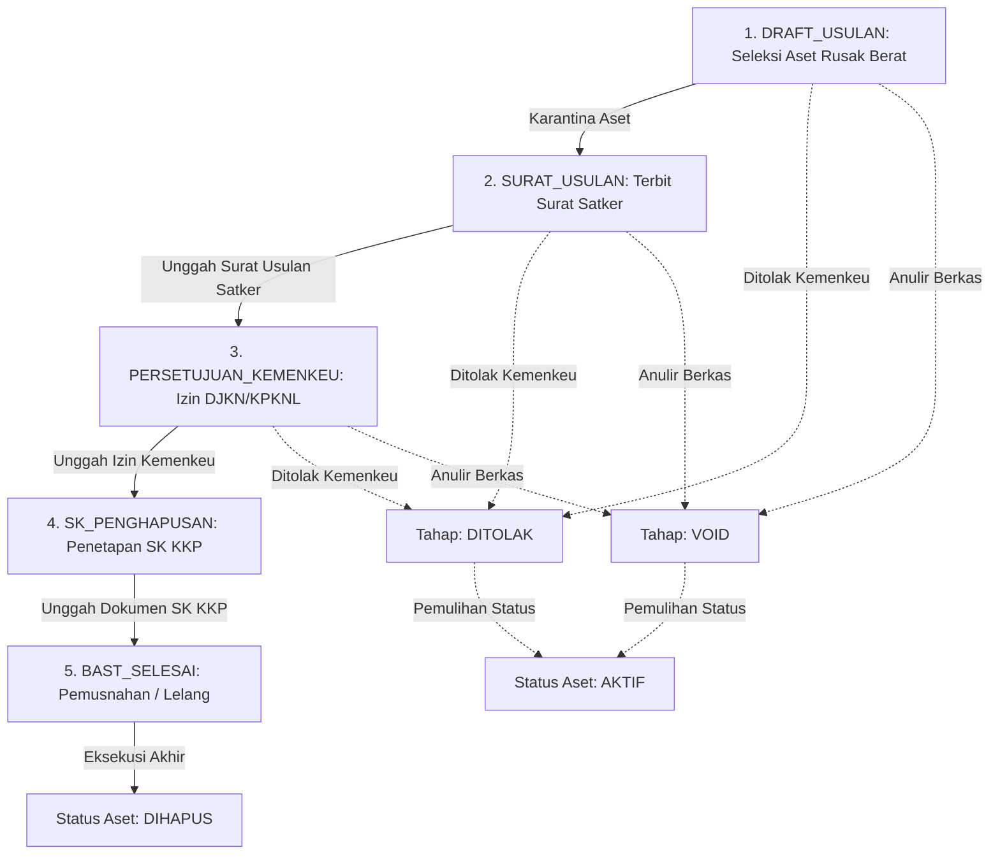

# PRD.md — Product Requirements Document: SIKAP
**Sistem Informasi Keuangan, Anggaran, dan Kepegawaian**  
*Subbag Tata Usaha — Direktorat Pemantauan dan Operasi Armada (Dit. POA)*  
*Direktorat Jenderal Pengawasan Sumber Daya Kelautan dan Perikanan (Ditjen PSDKP)*  
*Kementerian Kelautan dan Perikanan Republik Indonesia (KKP RI)*

---

## 1. Pendahuluan & Latar Belakang

### 1.1 Visi Sistem
Subbag Tata Usaha bertindak sebagai pusat saraf manajerial, administratif, dan logistik bagi Direktorat Pemantauan dan Operasi Armada (Dit. POA). Seluruh kesiapan operasional kapal pengawas, pemantauan satelit radar maritim, kesiapsiagaan armada, dan pemeliharaan alutsista laut bergantung langsung pada stabilitas serapan anggaran negara, kepatuhan pengadaan barang/jasa pemerintah, ketersediaan aparatur, serta legalitas aset inventaris Barang Milik Negara (BMN).

**SIKAP** dibangun sebagai aplikasi satelit mandiri berkinerja tinggi (*distributed satellite system*) yang didesain untuk:
1. Menyediakan visibilitas real-time terhadap penyerapan anggaran DIPA Dit. POA, baik pagu reguler maupun Anggaran Belanja Tambahan (ABT).
2. Memonitor siklus pengadaan paket pekerjaan lintas divisi secara terukur dan transparan.
3. Mencatat struktur headcount dan distribusi aparatur (PNS, PPPK, PPPK Paruh Waktu, PJLP, Magang).
4. Menyelenggarakan registrasi inventaris fisik BMN secara granular (1 unit = 1 baris) dengan dukungan geotagging otomatis dan impor SAKTI.
5. Mengawal state machine berkas usulan pemusnahan/penghapusan aset Rusak Berat menuju Kementerian Keuangan RI (DJKN/KPKNL).

### 1.2 Topologi Terisolasi (Isolasi Database & Storage)
Dalam ekosistem terdistribusi Dit. POA, SIKAP beroperasi dengan penyimpanan mandiri:
- **Database Utama:** Google Spreadsheet `RadarPOA_SIKAP_DB` (terpisah dari database master operasional armada guna mencegah *lock contention* dan batas kuota sel 10 juta sel Google Sheets).
- **Master Referensi:** Google Spreadsheet `RadarPOA_Master_DB` (dibaca secara read-only untuk data master lokasi UPT, divisi, dan opsi).
- **Drive Storage:** Google Drive root folder `POA_Evidence_SIKAP` (terbagi atas sub-direktori `Aset_BMN`, `Surat_Penghapusan`, dan `Kontrak_Paket`).

---

## 2. Prinsip Arsitektur Utama

### 2.1 Prinsip "Anti-Gabruk" (Modular Input Separation)
Form input dan antarmuka operasional Subbag Tata Usaha di SIKAP dipisahkan secara tegas menjadi 5 sub-modul independen. Dilarang keras menggabungkan payload, tombol submit, tabel riwayat, atau modal input antar-konteks. Setiap sub-modul memiliki alur kerja, validasi, dan hak akses yang berdiri sendiri:
- **[TU-A] Realisasi Anggaran (SP2D & Akrual)**
- **[TU-B] Monitoring Paket Pekerjaan & Pengadaan**
- **[TU-C] Manajemen Kepegawaian & Headcount**
- **[TU-D] Inventaris Aset Fisik BMN Granular (Anti-Jebret)**
- **[TU-E] Siklus Usulan Penghapusan Legal BMN Kemenkeu**

### 2.2 Prinsip "BMN Anti-Jebret" (Granular Single-Item Physical Tracking)
Seluruh pencatatan aset inventaris BMN wajib dilakukan per unit fisik individual (1 baris transaksi = 1 fisik unit riil). Dilarang keras membuat form input curah (*bulk aggregate*) seperti "Laptop 20 unit Rp 200.000.000". Setiap unit fisik wajib memiliki identitas katalog `KodeBarang` 10 digit Kemenkeu, nomor urut registrasi `NUP`, kondisi fisik riil, foto fisik, serta koordinat geotagging lokasi penempatan.

### 2.3 Prinsip "Kalkulasi Selalu Server-Side"
Seluruh formula finansial, akumulasi serapan YTD, sisa anggaran kas, selisih komitmen fisik, kalkulasi jarak Haversine ke UPT terdekat, dan perhitungan usia aset dieksekusi di backend Google Apps Script. Frontend hanya berfungsi untuk menampilkan representasi data dan tidak dipercaya untuk melakukan kalkulasi bisnis inti.

### 2.4 Pola Transaksi Non-Destruktif (Append-Only Versioning)
SIKAP menerapkan pola transaksi tanpa overwrite:
- **Revisi Data:** Baris lama ditandai dengan `Status = 'SUPERSEDED'`. Baris baru di-append dengan kolom `SupersedesRowID` yang menunjuk ke `RowID` lama.
- **Anulir Data:** Baris ditandai dengan `Status = 'VOID'`, dengan kewajiban mencatat `VoidReason`, `VoidedBy`, dan `VoidedAt`. Baris berstatus VOID tidak diperhitungkan dalam agregasi finansial namun tetap terekam permanen untuk audit.

---

## 3. Spesifikasi Fungsional Sub-Modul

### 3.1 Sub-Modul [TU-A]: Realisasi Anggaran (SP2D & Akrual)
Sub-modul ini menangani pencatatan dan monitoring mingguan penyerapan anggaran Dit. POA berbasis matriks 2x2 APBN:

```
                  ┌──────────────────────┬──────────────────────┐
                  │     PAGU REGULER     │       PAGU ABT       │
┌─────────────────┼──────────────────────┼──────────────────────┤
│ REALISASI SP2D  │ Kas Cair DIPA Induk  │ Kas Cair Angg. Tamb. │
├─────────────────┼──────────────────────┼──────────────────────┤
│ REALISASI AKRUAL│ Komitmen Fisik Induk │ Komitmen Fisik Tamb. │
└─────────────────┴──────────────────────┴──────────────────────┘
```

#### Komponen Data & Aturan Bisnis:
1. **Pagu Anggaran (`PaguReguler` & `PaguABT`):**
   - Nilai pagu berlaku tahunan dan diwariskan dari laporan minggu sebelumnya secara otomatis (*carry-forward*).
   - Jika terdapat perubahan nilai pagu (revisi DIPA / persetujuan revisi anggaran Kemenkeu), pengguna **wajib** mengisi `CatatanRevisiPagu`.
   - `PaguTotal = PaguReguler + PaguABT`.
2. **Realisasi SP2D Mingguan (`RealisasiSP2D_Reguler_Minggu` & `RealisasiSP2D_ABT_Minggu`):**
   - Nilai riil kas negara yang telah diterbitkan Surat Perintah Pencairan Dana (SP2D) oleh KPPN pada minggu berjalan.
   - Nilai wajib numerik $\ge 0$.
3. **Realisasi Akrual Mingguan (`RealisasiAkrual_Reguler_Minggu` & `RealisasiAkrual_ABT_Minggu`):**
   - Nilai komitmen atau capaian fisik pekerjaan yang telah diselesaikan pada minggu berjalan namun belum tentu seluruh kasnya cair.
   - Nilai wajib numerik $\ge 0$.
4. **Agregasi Server-Side (YTD):**
   - $\text{AkumulasiSP2D} = \sum \text{RealisasiSP2D\_Reguler} + \sum \text{RealisasiSP2D\_ABT}$
   - $\text{AkumulasiAkrual} = \sum \text{RealisasiAkrual\_Reguler} + \sum \text{RealisasiAkrual\_ABT}$
   - $\text{SisaPaguSP2D} = \text{PaguTotal} - \text{AkumulasiSP2D}$
   - $\text{SisaPaguAkrual} = \text{PaguTotal} - \text{AkumulasiAkrual}$
   - $\% \text{SerapanSP2D} = \left(\frac{\text{AkumulasiSP2D}}{\text{PaguTotal}}\right) \times 100\%$
   - $\% \text{SerapanAkrual} = \left(\frac{\text{AkumulasiAkrual}}{\text{PaguTotal}}\right) \times 100\%$
5. **Validasi & Proteksi:**
   - Satu periode minggu (`YYYY-MM-WW`) hanya boleh memiliki 1 baris berstatus `ACTIVE`.
   - Jika ingin mengubah laporan periode yang sama, pengguna harus menggunakan fitur **Revisi**.
   - Jika laporan dibatalkan oleh pimpinan (Kadiv/Direktur), laporan berstatus `VOID` membuka kembali periode tersebut untuk penginputan ulang.

---

### 3.2 Sub-Modul [TU-B]: Monitoring Paket Pengadaan
Sub-modul ini mengelola siklus hidup pengadaan barang, jasa konsultansi, konstruksi, dan pemeliharaan teknis di lingkungan Direktorat.

#### Siklus Hidup 6-Tahap (`TahapPekerjaan`):
1. `PERSIAPAN`: Penyusunan HPS, spesifikasi teknis, rancangan kontrak, dan identifikasi RUP.
2. `PEMILIHAN`: Proses tender/seleksi/e-katalog melalui UKPBJ KKP.
3. `KONTRAK`: Penandatanganan Surat Perjanjian Kontrak / SPK antara PPK dan rekanan penyedia.
4. `PELAKSANAAN`: Pengerjaan fisik / pengiriman barang di lapangan.
5. `BAST`: Serah terima hasil pekerjaan melalui Berita Acara Serah Terima.
6. `SELESAI`: Pembayaran final tuntas dan masa garansi/pemeliharaan selesai.

#### Aturan Validasi Pengadaan:
- Pada tahap $\ge$ `KONTRAK`, kolom `NomorKontrak`, `RekananPenyedia`, dan `NilaiKontrak` wajib terisi.
- Nilai `ProgresFisikPct` berada pada rentang numerik `0.0` s.d. `100.0`.
- Kolom `RealisasiKeuangan` tidak boleh melebihi `NilaiKontrak` (peringatan jika terjadi potensi *overpayment*).
- Setiap pembaruan progres dapat menyertakan lampiran berkas dokumen kontrak / foto fisik (`EvidenceUrl`).

---

### 3.3 Sub-Modul [TU-C]: Manajemen Kepegawaian & Headcount
Sub-modul ini memantau komposisi, ketersediaan, dan mutasi aparatur sipil dan personil pendukung di Subbag Tata Usaha.

#### 5 Kategori Aparatur Standar Pemerintah:
1. `PNS`: Pegawai Negeri Sipil tetap.
2. `P3K`: Pegawai Pemerintah dengan Perjanjian Kerja (Penuh Waktu).
3. `P3K_PARUH_WAKTU`: PPPK Paruh Waktu sesuai kebijakan reformasi birokrasi KemenPAN-RB.
4. `PJLP`: Penyedia Jasa Lainnya Perorangan / Tenaga Honorer / Pramubakti.
5. `MAGANG`: Peserta Magang Resmi Perguruan Tinggi / Taruna PKL Poltek KP.

#### Logika Snapshot Mingguan:
- Data kepegawaian disimpan berbasis periode snapshot (`YYYY-MM-WW`).
- Sistem menerapkan *carry-forward otomatis*: jika pada minggu berjalan belum ada mutasi atau perubahan personil, sistem secara otomatis merefleksikan komposisi headcount dari periode aktif terakhir tanpa mengharuskan input ulang.
- Jika terjadi mutasi (pensiun, promosi, penerimaan personil baru), form submit snapshot akan mencatat jumlah terbaru beserta catatan keterangan mutasi di `Keterangan`.

---

### 3.4 Sub-Modul [TU-D]: Inventaris BMN & Geotagging Granular
Sub-modul ini merupakan pilar inventaris fisik BMN Dit. POA yang dirancang tahan uji terhadap audit BPK dan BPKP.

#### Klasifikasi Akuntansi BMN:
- **`BUKU` (Intrakomptabel / Aset Tetap Neraca):**
  - Nilai perolehan $\ge$ batas minimal kapitalisasi (Belanja Modal Akun 53).
  - Dicatat dalam Neraca Keuangan Satker, memiliki nilai buku, dan disusutkan secara berkala.
- **`REGULER` (Ekstrakomptabel / Aset Operasional):**
  - Nilai perolehan di bawah batas kapitalisasi (Belanja Barang Akun 52).
  - Wajib dicatat identitas fisiknya, nomor inventaris internal, penempatan ruangan, dan kondisi operasionalnya.

#### Kondisi Fisik & Alerting:
- Status kondisi aset: `BAIK`, `RUSAK_RINGAN`, dan `RUSAK_BERAT`.
- Aset dengan kondisi `RUSAK_BERAT` otomatis memicu banner peringatan sistem dan direkomendasikan masuk ke daftar antrean usulan penghapusan BMN (Sub-Modul E).

#### Pipeline Geotagging Dual-Engine:
1. **Engine Utama (EXIF GPS Extraction):**
   - Saat pengguna memilih foto fisik aset dari kamera atau galeri, client membaca binary header EXIF file asli sebelum dilakukan kompresi kanvas.
   - Jika tag EXIF `GPSLatitude` dan `GPSLongitude` terdeteksi, koordinat langsung diekstraksi (`SumberLokasi = 'EXIF_GPS'`).
2. **Engine Fallback (Browser GPS & Homebase Profil):**
   - Jika foto tidak memiliki geotag EXIF (misal hasil transfer aplikasi chat yang menghapus metadata), sistem meminta izin GPS browser perangkat (`navigator.geolocation`) (`SumberLokasi = 'GPS_PENGUNGGAH'`).
   - Jika izin GPS browser ditolak atau perangkat desktop tanpa GPS, sistem menggunakan koordinat pangkalan homebase pada profil pengguna (`SumberLokasi = 'PROFIL_PENGUNGGAH'`).
3. **Haversine Distance Matcher (Server-Side):**
   - Backend menghitung jarak bola bumi lingkaran besar (*great-circle distance*) menggunakan formula Haversine terhadap seluruh daftar pangkalan UPT di `Master_Lokasi_UPT`.
   - Menghasilkan nilai `LokasiID` UPT terdekat serta jarak fisik presisi dalam kilometer (`JarakKeUPT_Km`).

#### Smart Bulk Import SAKTI Excel (.xlsx / .csv):
- Mendukung unggah berkas rekapitulasi BMN langsung dari aplikasi SAKTI / SIMAK Kemenkeu hingga 5.000 baris.
- Menyediakan antarmuka **Salin-Tempel (Paste Grid)** langsung dari sel spreadsheet.
- **Validasi Dry-Run:** Menganalisis keabsahan kode barang, format tanggal, pemetaan kategori, dan validitas NUP tanpa menulis ke database.
- Menampilkan 4 kartu statistik uji validasi (Total Baris, Siap Diimpor, Baris Galat, Akumulasi Nilai Perolehan) serta pratinjau tabel sebelum batch commit.

---

### 3.5 Sub-Modul [TU-E]: Siklus Usulan Penghapusan Legal BMN Kemenkeu
Sub-modul ini mengatur alur tata kelola hukum pemusnahan, penjualan, atau penghapusan aset BMN yang sudah Rusak Berat atau kadaluwarsa menuju Kementerian Keuangan RI (DJKN/KPKNL) sesuai PMK tata cara penghapusan BMN.



#### State Machine 5-Tahap:
1. `DRAFT_USULAN`: Staf BMN mengumpulkan aset-aset `RUSAK_BERAT` yang eligible dan berstatus `AKTIF`.
2. `SURAT_USULAN`: Penerbitan surat usulan resmi Satker ke Sekretariat Ditjen / Biro Keuangan / Pengelola Barang Kemenkeu + unggah scan surat.
3. `PERSETUJUAN_KEMENKEU`: Penerbitan surat persetujuan penjualan/pemusnahan dari DJKN/KPKNL + unggah bukti persetujuan.
4. `SK_PENGHAPUSAN`: Penerbitan Surat Keputusan (SK) Penghapusan BMN oleh Pengguna Barang KKP + unggah file SK PDF.
5. `BAST_SELESAI`: Pelaksanaan fisik pemusnahan / risalah lelang resmi KPKNL tuntas + unggah Berita Acara Serah Terima (BAST).

#### Mekanisme Karantina Aset (`StatusAset`):
- Saat aset dimasukkan ke dalam berkas usulan penghapusan, status aset di tabel `TX_BMN_Aset` otomatis diubah dari `AKTIF` menjadi `DALAM_PENGHAPUSAN`.
- Aset dalam masa karantina tidak dapat dimasukkan ke berkas usulan lain atau diedit kondisinya.
- Pada tahap akhir `BAST_SELESAI`, status seluruh aset dalam berkas otomatis berubah permanen menjadi `DIHAPUS`.
- Jika berkas usulan berstatus `DITOLAK` atau `VOID` (dianulir), sistem otomatis memulihkan (*auto-recovery*) status seluruh aset terkait kembali menjadi `AKTIF`.

---

## 4. Matriks Hak Akses & RBAC (Role-Based Access Control)

| Operasi Sistem | SUPERADMIN | DIREKTUR | KADIV (DIV-TU) | STAF (DIV-TU) | STAF (Divisi Lain) |
|---|:---:|:---:|:---:|:---:|:---:|
| **Baca Data TU-A, B, C, D, E** | Ya | Ya | Ya | Ya | Terbatas (Read-Only) |
| **Submit Laporan Anggaran (TU-A)** | Ya | Tidak | Ya | Ya | Tidak |
| **Revisi Laporan Anggaran (TU-A)** | Ya | Tidak | Ya | Ya | Tidak |
| **Anulir Laporan Anggaran (TU-A)** | Ya | Ya | Ya | Tidak | Tidak |
| **Update Progres Paket (TU-B)** | Ya | Tidak | Ya | Ya | Tidak |
| **Update Snapshot Pegawai (TU-C)**| Ya | Tidak | Ya | Ya | Tidak |
| **Registrasi & Impor BMN (TU-D)** | Ya | Tidak | Ya | Ya | Tidak |
| **Anulir Entri Aset BMN (TU-D)**   | Ya | Ya | Ya | Tidak | Tidak |
| **Buat Usulan Penghapusan (TU-E)**| Ya | Tidak | Ya | Ya | Tidak |
| **Advance Tahap Berkas (TU-E)**   | Ya | Tidak | Ya | Tidak | Tidak |
| **Anulir Usulan Penghapusan (TU-E)**| Ya | Ya | Ya | Tidak | Tidak |
| **Manajemen Pengguna & Approval** | Ya | Tidak | Ya (Persetujuan Staf TU) | Tidak | Tidak |

---

## 5. Persyaratan Non-Fungsional

1. **Integritas Konkurensi:** Seluruh operasi penulisan (*write operations*) ke Google Sheets wajib menggunakan `LockService.getScriptLock()` dengan batas tunggu (*timeout*) 15 s.d. 30 detik untuk mengeliminasi potensi *race condition*.
2. **Kinerja & Responsivitas:**
   - Waktu inisialisasi awal SPA frontend $\le 2.0$ detik pada koneksi internet standar (3G/4G).
   - Seluruh transaksi baca memanfaatkan teknik agregasi memori berbasis `sheetToObjects()`.
3. **Penyimpanan Berkas Drive:**
   - Batas maksimal ukuran lampiran berkas dokumen/foto adalah 15 MB.
   - Batas maksimal ukuran lampiran video dokumentasi adalah 50 MB.
4. **Kepatuhan Tampilan & Aksesibilitas:**
   - Mendukung penuh resolusi layar dari laptop standar (1366x768) hingga monitor desktop 4K (3840x2160).
   - Memenuhi standar Apple HIG: respons sentuh taktikal `:active { transform: scale(0.975); }`, kedalaman optik translusen `backdrop-filter: blur(24px)`, dan tipografi numerik `tabular-nums`.
   - **Zero-Emoji Policy:** Seluruh elemen teks antarmuka, tombol, tabel, dan notifikasi wajib bersih dari emoji grafis/unicode; ikon wajib menggunakan SVG presisi stroke-width 2px.

---

## 6. Kriteria Penerimaan (Acceptance Criteria)

- [x] Seluruh 5 sub-modul mandiri memiliki form input, modal revisi, modal anulir, dan tabel riwayat independen tanpa tumpang tindih (*Anti-Gabruk*).
- [x] Input inventaris BMN dilakukan per-item fisik (1 unit = 1 baris) dengan kode katalog dan NUP resmi (*BMN Anti-Jebret*).
- [x] Kalkulasi serapan nasional, sisa pagu kas, dan penentuan UPT terdekat berbasis Haversine 100% diproses server-side.
- [x] Seluruh kontrol UI terikat konsisten pada 3-tier kontainer (`40px`, `32px`, `26px`) dan lolos audit `node lint_ui.js` dengan skor sempurna tanpa pelanggaran.
- [x] Siklus usulan penghapusan BMN berhasil mengunci aset (`DALAM_PENGHAPUSAN`), menyelesaikan ke status `DIHAPUS` pada tahap BAST, dan memulihkan aset ke status `AKTIF` jika berkas dianulir.
